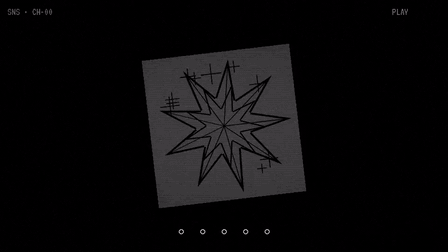

<div align="center">

# 🕹️ shutterbug.

**a retro personal-OS portfolio — it boots, it flips to film-negative, it plays tapes,
and your work lives inside a 3D handheld console with a CRT screen.**



[](https://nextjs.org)
[](https://threejs.org)
[](https://react.dev)
[](https://typescriptlang.org)
[](https://tailwindcss.com)
[](LICENSE)
[](https://bun.sh)

[**▶ open the live site**](https://preview-chat-aff97a5a-498d-4771-91ab-5225b435aab9.space-z.ai/) &nbsp;·&nbsp;
[**🧰 recreate it with the prompt kit**](docs/PROMPT_KIT.md) &nbsp;·&nbsp;
[**🐛 report an issue**](https://github.com/e2sy/shutterbug/issues)

</div>

---

## what is this

`shutterbug.` behaves like a tiny operating system from an alternate 1997: it **boots**
with a typewriter sequence, the whole site can **invert** like film negative with one
button, music rolls as a **two-tape deck** in the corner HUD, and the work gallery is a
**drag-to-rotate 3D console** rendered with raw Three.js — d-pad, face buttons, CRT
shader and all. this repo is the complete source: every image, reel, badge and the
ambient track are generated by scripts in this repo. nothing is stock.

## features

- **boot OS shell** — a typewriter boot sequence on first paint, then the site "logs in"
- **invert theme** — one button flips the entire site to film-negative via `mix-blend-mode: difference`
- **dual-tape audio deck** — two-track music system with fade-in, silent-roll until first
  gesture (autoplay-policy safe), session-persistent track memory, and a now-playing readout
- **3D handheld console** — shell, d-pad, face buttons, and a CRT-shader screen driven by a
  live canvas; drag to rotate, keyboard controls, rail navigation between works
- **tracking overlay scroll engine** — sections snap and track like VHS
- **motion-graphic socials** — a generated reel of every social plays right on the console screen
- **fully self-made assets** — posters, reels, badges and the ambient loop are all generated
  by scripts in [`scripts/`](scripts/) (ffmpeg / PIL / numpy)
- **responsive + reduced-motion aware** — 390px mobile verified, honors `prefers-reduced-motion`

## tech stack

| layer      | what it uses                                        |
|------------|-----------------------------------------------------|
| framework  | Next.js 16 (App Router) + React 19 + TypeScript     |
| 3D         | Three.js (raw, no wrapper) — `src/components/site/Machine.tsx` |
| styling    | Tailwind CSS 4 + hand-rolled CSS (`src/components/site/site.css`) |
| audio      | HTMLAudio + Web Audio-style volume ramps            |
| media gen  | ffmpeg (Ken Burns reels), PIL (posters), numpy (ambient loop) |
| font       | [VT323](https://fonts.google.com/specimen/VT323) (SIL OFL, self-hosted) |

## quickstart

```bash
# bun (recommended)
bun install
bun run dev        # → http://localhost:3000

# or npm
npm install
npm run dev
```

no env vars, no database, no API keys. it is a pure front-end site — open it and it boots.

## controls

| input                | action                                  |
|----------------------|-----------------------------------------|
| `invert` (HUD)       | flip the whole site to negative         |
| `music on/off` (HUD) | start / stop the deck                   |
| `track >>` (HUD)     | skip to the next tape                   |
| drag the console     | rotate it in 3D                         |
| `←` / `→`            | previous / next work on the console     |
| `X`                  | jump to the current work's link         |

## make it yours — the swap map

six edits and the site is fully yours:

1. **name, bio, taglines** → `src/components/site/Site.tsx` (hero + about sections)
2. **social links** → same file, contact section (`github / youtube / telegram / x / discord`)
3. **tracks** → `TRACKS` array at the top of `Site.tsx` (name, `src`, volume)
4. **works** → `src/lib/works.ts` (title, year, poster `img`, optional `vid`, `link`)
5. **colors & fonts** → CSS variables at the top of `src/components/site/site.css`
6. **console content** → `src/components/site/Machine.tsx`

## add your own song

this repo ships **without** the track used on the live site (it's a copyrighted
song — "Reflections" by The Neighbourhood — and it can't be redistributed here).
the deck auto-skips to the bundled ambient loop (`theme.mp3`, generated by
[`scripts/gen_audio.py`](scripts/gen_audio.py)) when your file is missing.

to use your own track:

```bash
cp your-song.mp3 public/assets/audio/reflections.mp3   # or edit TRACKS in Site.tsx
```

use music you have the rights to publish — a purchased copy for personal listening
is not a license to redistribute.

## regenerate all media from scratch

every asset on the site is produced by scripts in [`scripts/`](scripts/):

```bash
bash scripts/gen_media.sh        # Ken Burns 6s mp4 reels  → public/assets/reels/
python scripts/gen_images.py     # posters, badges, elements → public/assets/works|el/
python scripts/gen_audio.py      # ambient loop (numpy synth) → public/assets/audio/
python scripts/gen_socials_video.py  # socials motion graphic → public/assets/reels/socials.mp4
```

## recreate it with AI — the prompt kit

this whole site was rebuilt live with an AI coding agent, and the exact kit used
for the video is included: **[docs/PROMPT_KIT.md](docs/PROMPT_KIT.md)**

it contains a one-shot mega-prompt, five phased prompts (they double as tutorial
chapters), a build guide, a swap map, and YouTube extras. paste it into any strong
coding agent and you get this site.

## credits

- design inspiration: [shutterkif-oss.github.io](https://shutterkif-oss.github.io/) — rebuilt from zero, original code and assets
- VT323 font by Peter Hull, SIL Open Font License

## license

[MIT](LICENSE) — free to fork, remix, and ship. attribution appreciated, never required.

<div align="center">

*booted, inverted, and shipped with 🔊 by [e2sy](https://github.com/e2sy)*

</div>
